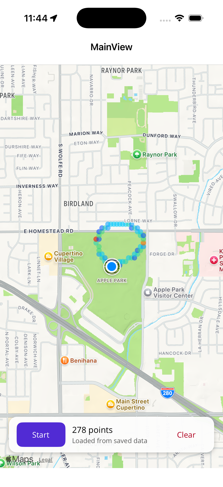

# Location Heat Map — .NET MAUI

A cross-platform location tracker that records where you go, saves every position to a local
SQLite database, and draws the accumulated history on a map as a heat map: cold blue where you
passed through once, hot red where you spent time.

Built with C# and .NET MAUI for **iOS** environment.



---

## What it does

Press **Start** and the app samples your position every three seconds, writing each fix to
SQLite. Every fifth fix it re-aggregates the stored history onto a ~33 m grid, counts how many
fixes landed in each cell, and redraws the map overlay with one translucent circle per occupied
cell — coloured along a blue → cyan → lime → yellow → red ramp by how busy that cell is.

Because every fix is persisted rather than held in memory, closing and reopening the app redraws
the heat map you have already built up.

---

## How the heat map works

.NET MAUI's `Map` control has no heat layer. What it does have is a `MapElements` collection,
and a `Circle` element with its own centre, radius and fill colour. Extending the control into a
heat map therefore comes down to deciding what circles to draw and what colour to make them —
which is all `Services/HeatMapRenderer.cs` does.

1. **Quantise.** Each stored fix is snapped to a grid with `ROUND(Latitude / 0.0003) * 0.0003`.
   At ~111 km per degree of latitude that is about 33 m — fine enough to follow one side of a
   street, coarse enough that GPS jitter while you stand still lands in a single cell.
   The grouping runs in SQL, so SQLite collapses thousands of rows into the few dozen occupied
   cells before any of it reaches C#.

2. **Normalise.** Counts are scaled to 0–1 against the busiest cell **logarithmically**.
   A linear scale behaves badly here: one long coffee stop produces a count far above everything
   else, which would push every other cell to the cold end and flatten the map to uniform blue.

3. **Colour and draw.** The normalised value indexes a five-stop colour ramp, interpolated in
   RGB, at 55% alpha so the streets stay readable. One `Circle` per cell goes into `MapElements`.

The consequence worth noting is that **sampling is time-based, not distance-based**. A distance
filter is the obvious way to avoid duplicate rows, but it would discard exactly the data that
makes a heat map interesting — standing still is what is supposed to turn a cell red.

---

## Project layout

```
LocationHeatMap/
├── Models/
│   ├── LocationRecord.cs      One stored GPS fix (the SQLite table)
│   └── HeatCell.cs            One grid cell plus its visit count
├── Services/
│   ├── ILocationDatabase.cs   Persistence contract
│   ├── LocationDatabase.cs    sqlite-net async connection + the aggregation query
│   ├── ILocationTrackingService.cs
│   ├── LocationTrackingService.cs  Permissions + the foreground geolocation listener
│   └── HeatMapRenderer.cs     Cells → coloured Circles  ← extends the Map control
├── ViewModels/
│   └── MainViewModel.cs       Tracking state, counters, rebuild scheduling
├── Views/
│   ├── MainView.xaml          Map + the floating control strip
│   └── MainView.xaml.cs       The little that genuinely needs the Map reference
├── Platforms/
│   ├── Android/AndroidManifest.xml   Permissions + Google Maps API key
│   └── iOS/Info.plist                Location usage description
└── MauiProgram.cs             UseMauiMaps() and dependency injection
```

The view model holds no reference to the `Map` control. It raises an event carrying freshly
aggregated cells and lets the code-behind apply them, which keeps every MAUI Maps type out of
the view model.

---

## Running it

Full instructions, including every prerequisite and the version pitfalls, are in
**[SETUP.md](SETUP.md)**. The short version, once your environment is set up:

```bash
cd LocationHeatMap

# iOS
xcrun simctl boot <UDID> && open -a Simulator
dotnet build -t:Run -f net10.0-ios26.0 -p:_DeviceName=:v2:udid=<UDID>

```

Then move around — or simulate movement, since a stationary simulator produces a single dot:

- **iOS Simulator:** *Features → Location → Freeway Drive*

### Two things that will bite you

**The iOS target framework is `net10.0-ios26.0`, not `net10.0-ios`.** The `26.0` suffix selects
the Apple SDK band that works with Xcode 26. Without it the build demands Xcode 27. If you are
on a newer Xcode, drop the suffix. See Step 4 of SETUP.md.

---

## Dependencies

| Package | Why |
|---|---|
| `Microsoft.Maui.Controls.Maps` | The `Map` control and `Circle` map element |
| `sqlite-net-pcl` | Lightweight async SQLite ORM |
| `SQLitePCLRaw.bundle_e_sqlite3` | The native SQLite provider, pinned to the 3.x line |
| `CommunityToolkit.Mvvm` | `ObservableObject` and `[RelayCommand]` source generators |

The SQLite provider deserves a note. `sqlite-net-pcl` pulls in `SQLitePCLRaw.bundle_green`
2.1.11 by default, whose native SQLite builds are affected by
[GHSA-2m69-gcr7-jv3q](https://github.com/advisories/GHSA-2m69-gcr7-jv3q). This project uses
`bundle_e_sqlite3` 3.0.5 instead, which carries a patched SQLite and resolves the advisory.
(Pinning only the native `lib.e_sqlite3` packages forward to 2.1.13 also clears the warning, but
crashes at startup on Android with a `SQLiteConnection` type-initializer failure — the managed
2.1.11 provider cannot load the newer native library. The whole-bundle upgrade is the fix that
actually works.)

---

## Privacy

Location data never leaves the device. It is written to `locations.db3` in the app's private
data directory, there is no network code beyond the map tiles the platform fetches, and
**Clear** deletes every stored row. Tracking is foreground-only: leaving the page releases the
platform's location listener, so the app cannot record you while it is in the background.
